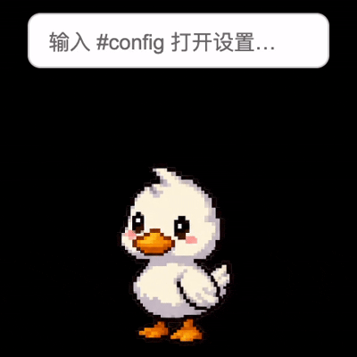

# 2ya-MVP

桌面宠物 MVP 版本

## 功能

1. 宠物ui：宠物本体、右键宠物ui附近弹出对话框（输入快捷指令"#config"弹出配置ui）、左键队宠物进行互动（目前只有walk动作，所以看不出互动效果）
2. 配置ui：设置宠物、名称等

## 技术架构

核心架构：React（渲染）+ Electron（主程 + Python（业务）。
通信架构：React 与 Electron 通过 ipc 通信；python 与 Electron 通过 pipe 通信。

## 如何启动

1. 装备 uv、node + npm 环境
2. uv 安装python相关依赖
   ```bash
   uv sync
   ```
3. 安装 web 相关依赖
   ```bash
   $ npm install
   ```
4. 本地启动
   ```bash
   $ npm run dev
   ```
5. 构建
   ```bash
   # For windows
   $ npm run build:win

   # For macOS
   $ npm run build:mac

   # For Linux
   $ npm run build:linux
   ```

## 效果



## 协议

遵循 [Apache License Version 2.0](./LICENSE)

## 版本

采用 [SemVer v2.0.0](https://semver.org/lang/zh-CN/spec/v2.0.0.html)

项目处于 0.x 阶段，MINOR 版本可能包含不兼容变更；1.0 后遵循严格 SemVer。
